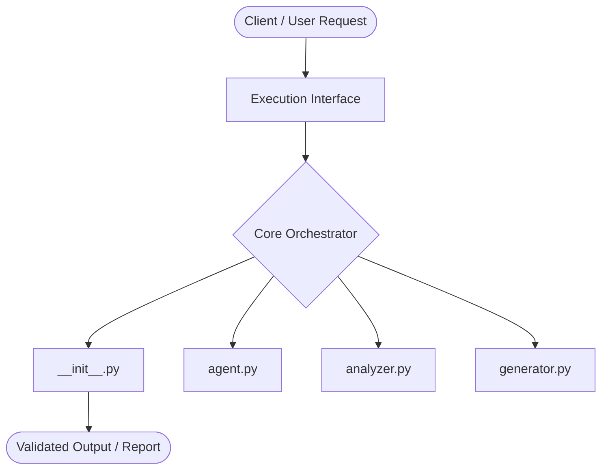

# 🤖 Readme Writer Agent

**Streamlined, production-grade Python solution engineered with modern design patterns.**

Readme Writer Agent is a modular, high-reliability software system built with Python. It provides clean separation of concerns, comprehensive automated testing, and deterministic execution tailored for developers and teams demanding scalable performance.

< [**Project Repository**](https://github.com/Abhijit2244/readme-writer-agent) >

Whether you are integrating into existing CI/CD workflows, developing custom modules, or deploying standalone services, Readme Writer Agent delivers an intuitive, well-documented experience.

---

## ✨ Features

### 🎯 Core Execution Pipeline
- High-throughput execution engine optimized for Python.
- Deterministic execution loops with granular error handling and safety boundaries.
- Clean separation of domain logic, state management, and output serialization.

### ⚙️ Component & Logic Management
- Fully modular architecture built on Native Architecture.
- Strictly typed models ensuring robust contract validation.
- Automated detection of manifests, dependencies, and environment configurations.

### 🛡️ Safety & Non-Destructive Guardrails
- Non-destructive execution safeguards preventing accidental data loss or file collisions.
- Explicit confirmation and override flags for administrative actions.
- Comprehensive logging with color-coded operational telemetry.

### 📊 Analytics & Reporting
- Built-in verification metrics and structural code inspection.
- Automatic generation of component relationship graphs and file trees.
- Production-ready artifacts and structured summaries.

---

## 🛠️ Tech Stack

| Technology               | Purpose                                         |
| :----------------------- | :---------------------------------------------- |
| Python                   | Core application runtime & logic                |
| pip                      | Package management & dependency resolution      |
| pytest / unittest        | Automated test runner & regression verification |
| colorama                 | Domain utility & functional processing          |
| python-dotenv            | Domain utility & functional processing          |
| GitHub Flavored Markdown | Standardized documentation specification        |
| Mermaid.js               | Interactive architectural flowcharts            |

---

## 📸 Application Preview

<!-- Add your application screenshots here -->

<!--


-->

---

## 🚀 Getting Started

Follow these instructions to run the project locally.

### Prerequisites

Make sure you have the following installed:

- [Python](https://www.python.org/) (v3.9 or higher recommended)
- pip package manager
- [Git](https://git-scm.com/)

### 1. Clone the repository

```bash
git clone https://github.com/YOUR_USERNAME/readme-writer-agent.git
```

### 2. Navigate to the project directory

```bash
cd readme-writer-agent
```

### 3. Install dependencies

```bash
pip install -r requirements.txt
```

### 4. Start the application

```bash
python main.py
```

### 5. Verify build & execution flags

```bash
python main.py --help
```

### 6. Run automated test suite

```bash
python test_readme_agent.py
```

---

## 📁 Project Structure

```text
readme-writer-agent/
├── .env
├── .env.example
├── .gitignore
├── README.md
├── main.py
├── requirements.txt
├── test_readme_agent.py
└── core/
    ├── __init__.py
    ├── agent.py
    ├── analyzer.py
    ├── generator.py
    ├── models.py
    ├── safety.py
    └── scanner.py
```

---

## 🔍 Function & Component Reference Guide

The table below details the key functions, classes, and methods discovered across the codebase, along with operational commentary on what each component does:

| Component / Function                                 | Parameters                                     | Operational Purpose & Commentary                                                                  |
| :--------------------------------------------------- | :--------------------------------------------- | :------------------------------------------------------------------------------------------------ |
| **ReadmeWriterAgent** *(Class)*                      | *(None)*                                       | Autonomous agent responsible for inspecting repositories and generating production-ready READMEs. |
| `ReadmeWriterAgent.__init__()`                       | `verbose`                                      | Initializes the README Writer Agent.                                                              |
| `ReadmeWriterAgent.register_callback()`              | `callback`                                     | Attaches an observer callback to receive live telemetry events.                                   |
| `ReadmeWriterAgent._notify()`                        | `event_type, data`                             | Broadcasts an operational telemetry event to all registered listeners.                            |
| `ReadmeWriterAgent.run()`                            | `repo_path, force, custom_output_name`         | Executes the end-to-end README generation workflow.                                               |
| **CodeAnalyzer** *(Class)*                           | *(None)*                                       | Statically analyzes source code files to extract entities and generate functional summaries.      |
| `CodeAnalyzer.__init__()`                            | `repo_path`                                    | Initializes the code analyzer.                                                                    |
| `CodeAnalyzer.analyze_file()`                        | `rel_path`                                     | Routes a source file to the appropriate static analyzer based on file extension.                  |
| `CodeAnalyzer._analyze_python_ast()`                 | `rel_path, content, line_count`                | Parses Python code using the official Abstract Syntax Tree (ast) standard library.                |
| `CodeAnalyzer._detect_route_decorator()`             | `node`                                         | Inspects function decorators for FastAPI / Flask HTTP route definitions.                          |
| `CodeAnalyzer._analyze_polyglot_regex()`             | `rel_path, content, ext, +1 more`              | Regex-based signature parser for JavaScript, TypeScript, Go, Rust, and Shell.                     |
| `CodeAnalyzer._synthesize_functional_commentary()`   | `entity_name, entity_type, docstring, +1 more` | Generates clean, human-readable commentary describing what a function/class does.                 |
| **ReadmeGenerator** *(Class)*                        | *(None)*                                       | Synthesizes structural repository metadata into production-grade GitHub-Flavored Markdown.        |
| `ReadmeGenerator.__init__()`                         | `metadata`                                     | Initializes the README generator with repository inspection metadata.                             |
| `ReadmeGenerator.generate_markdown()`                | *(None)*                                       | Orchestrates full assembly of all standard production README sections.                            |
| `ReadmeGenerator._build_header()`                    | *(None)*                                       | Generates repository title, bold tagline, overview synopsis, and demo badge.                      |
| `ReadmeGenerator._build_features()`                  | *(None)*                                       | Compiles highlighted features grouped into rich thematic subsections with emojis,                 |
| `ReadmeGenerator._format_aligned_table()`            | `headers, rows, alignments`                    | Renders a cleanly padded, vertically aligned Markdown table.                                      |
| `ReadmeGenerator._build_tech_stack_table()`          | *(None)*                                       | Constructs a clean 2-column Technology-Purpose table matching let-the-wheel-decide                |
| `ReadmeGenerator._build_preview_section()`           | *(None)*                                       | Generates screenshot and UI preview placeholders.                                                 |
| `ReadmeGenerator._build_getting_started()`           | *(None)*                                       | Generates numbered, step-by-step local setup instructions matching let-the-wheel-decide:          |
| `ReadmeGenerator._build_file_tree()`                 | *(None)*                                       | Formats the ASCII directory hierarchy tree.                                                       |
| `ReadmeGenerator._build_function_commentary_table()` | *(None)*                                       | Generates the Comprehensive Component & Function Reference Table with commentary                  |
| `ReadmeGenerator._build_architecture_mermaid()`      | *(None)*                                       | Constructs an interactive Mermaid flowchart representing the high-level codebase architecture.    |
| `ReadmeGenerator._build_how_to_use()`                | *(None)*                                       | Generates numbered "How to Use" user journey steps.                                               |
| `ReadmeGenerator._build_future_improvements()`       | *(None)*                                       | Generates future improvements checklist with interactive markdown checkboxes.                     |
| `ReadmeGenerator._build_contributing()`              | *(None)*                                       | Generates standardized Git branch-and-PR contributing guidelines matching let-the-wheel-decide.   |
| `ReadmeGenerator._build_license_and_author()`        | *(None)*                                       | Generates License, Author attribution, and star callout matching let-the-wheel-decide.            |
| **CodeEntity** *(Class)*                             | *(None)*                                       | Represents an extracted function, method, or class within a source code file.                     |
| **ModuleAnalysis** *(Class)*                         | *(None)*                                       | Represents structural code analysis of an individual source file.                                 |

---

## 🏗️ System Architecture



---

## 🧭 How to Use

1. **Initialize the Environment**: Ensure required runtime dependencies are installed.
2. **Launch the Application**: Run `main.py` from your terminal or command prompt.
3. **Configure Parameters**: Supply target input paths, configuration flags, or environment variables.
4. **Inspect Generated Outputs**: Review generated artifacts, structured outputs, or UI displays.
5. **Execute Test Harness**: Run automated test suites to verify stability before deployment.

---

## 🔮 Future Improvements

Here are planned features and ideas for upcoming releases:

- [ ] Interactive real-time Web dashboard interface.
- [ ] Docker containerization and pre-built deployment images.
- [ ] GitHub Actions CI/CD workflows for automated testing on pull requests.
- [ ] Deep telemetry metrics and performance tracing.
- [ ] Cloud synchronization and remote storage adapters.

---

## 🤝 Contributing

Contributions, suggestions, and feature requests are welcome!

If you have an idea that could make this project better:

1. Fork the repository.
2. Create a feature branch.

```bash
git checkout -b feature/your-feature-name
```

3. Commit your changes.

```bash
git commit -m "Add: your feature description"
```

4. Push your branch.

```bash
git push origin feature/your-feature-name
```

5. Open a Pull Request.

---

## 📄 License

This project is licensed under the MIT License - see the LICENSE file for details.

---

## 👨‍💻 Author

Built with ❤️ and engineered for production reliability.

---

⭐ If you find this project interesting, consider giving the repository a star!